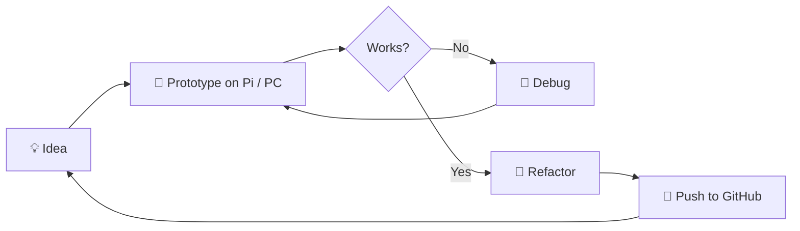

<!-- Place this file in a public repo named exactly: rnageswa/rnageswa -->

<div align="center">


<a href="https://github.com/rnageswa">
  
</a>

<br/>


</div>

---

## `~/about-me`

```python
class Developer:
    def __init__(self):
        self.name      = "Nooka Nageswararao"
        self.github    = "rnageswa"
        self.location  = "Chennai, India 🇮🇳"
        self.languages = ["Python", "C++", "C#", "CSS"]
        self.playground = ["Raspberry Pi", "Embedded / IoT", "Workflow Automation"]
        self.learning  = "Programming, Data Structures & Algorithms (IIT Madras)"

    def current_focus(self):
        return [
            "🔐 Hardware + software security projects",
            "🤖 Automating anything repetitive",
            "📚 Sharpening DSA fundamentals",
        ]

    def philosophy(self):
        return "Build it small. Make it work. Then make it better."

me = Developer()
print(me.philosophy())
```

---

## 🧰 Tech Arsenal

<div align="center">


</div>

| Domain | What I play with |
|---|---|
| 🧠 **Languages** | Python · C++ · C# · HTML/CSS |
| 🔌 **Embedded / IoT** | Raspberry Pi · microcontrollers · door-lock & access systems |
| ⚙️ **Automation** | Workflow engines · video/text-to-speech pipelines · scripting |
| 🚗 **Protocols** | UDS-style diagnostics tooling |
| 🛠️ **Tools** | Git · GitHub · Linux · VS Code |

---

## 🚀 Featured Projects

<table>
  <tr>
    <td width="50%" valign="top">
      <h3>🔐 <a href="https://github.com/rnageswa/SecurityDoorLock">SecurityDoorLock</a></h3>
      
      <p>An embedded door-lock security system, where firmware meets the real world.</p>
    </td>
    <td width="50%" valign="top">
      <h3>🍓 <a href="https://github.com/rnageswa/myapp">myapp</a></h3>
      
      
      <p>My first Raspberry Pi application, where it all started.</p>
    </td>
  </tr>
  <tr>
    <td width="50%" valign="top">
      <h3>🎬 <a href="https://github.com/rnageswa/Automatic-Youtube-Reddit-Text-To-Speech-Video-Generator-and-Uploader">Reddit → YouTube Auto Generator</a></h3>
      
      <p>Pipeline that turns Reddit posts into text-to-speech videos and uploads them automatically.</p>
    </td>
    <td width="50%" valign="top">
      <h3>📡 <a href="https://github.com/rnageswa/uds">uds</a></h3>
      
      <p>Python experiments with Unified Diagnostic Services.</p>
    </td>
  </tr>
  <tr>
    <td width="50%" valign="top">
      <h3>🔄 <a href="https://github.com/rnageswa/Wexflow">Wexflow</a></h3>
      
      <p>Fork of an open-source workflow automation engine, with contributions along the way.</p>
    </td>
    <td width="50%" valign="top">
      <h3>🎓 <a href="https://github.com/rnageswa/IITM-PDSA">IITM-PDSA</a></h3>
      
      <p>My Programming, Data Structures &amp; Algorithms coursework journey at IIT Madras.</p>
    </td>
  </tr>
</table>

---

## 🧭 How I Work (a tiny flowchart)



---

## 📊 GitHub Stats

<div align="center">


</div>

---

## 🏅 Achievements

<div align="center">


**🦈 Pull Shark ×2 · 👯 Pair Extraordinaire**

</div>

---

## 🐍 Contribution Snake

<div align="center">

<picture>
  <source media="(prefers-color-scheme: dark)" srcset="https://raw.githubusercontent.com/rnageswa/rnageswa/output/github-snake-dark.svg" />
  <source media="(prefers-color-scheme: light)" srcset="https://raw.githubusercontent.com/rnageswa/rnageswa/output/github-snake.svg" />
  
</picture>

</div>

<!-- The snake needs the GitHub Action in .github/workflows/snake.yml (provided separately). -->

---

## 🎯 Currently

- 🔭 Building small embedded + automation projects
- 🌱 Strengthening DSA with the IIT Madras programme
- 🤝 Open to collaborating on **Python**, **C++**, **IoT** and **automation** projects
- 💬 Ask me about: Raspberry Pi, door-lock systems, diagnostics (UDS), workflow automation

## 🤝 Let's Connect

<div align="center">

<a href="https://github.com/rnageswa"></a>
<!-- Add your own links below: -->
<!-- <a href="https://www.linkedin.com/in/YOUR-HANDLE"></a> -->
<!-- <a href="mailto:YOUR-EMAIL"></a> -->

<br/><br/>

*"First, solve the problem. Then, write the code."*


</div>
